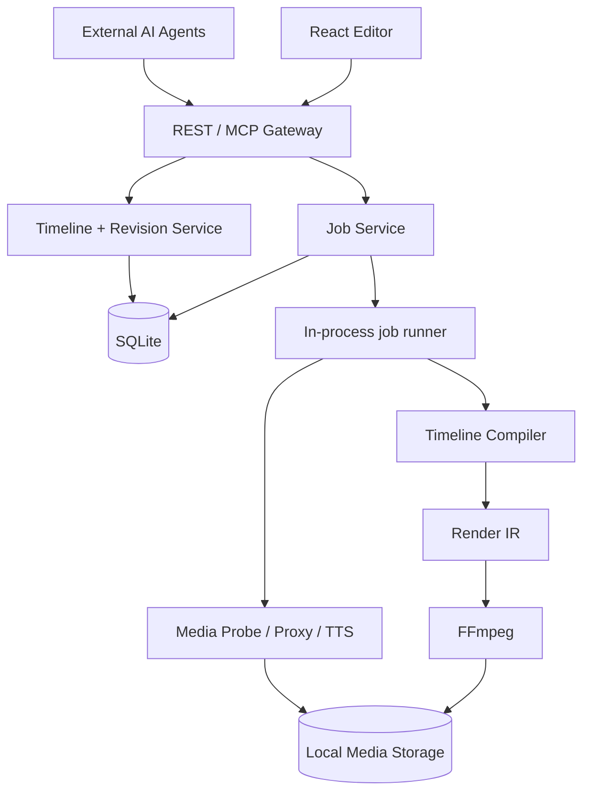
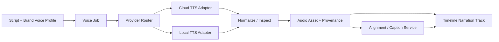

# AI Video Studio — System Architecture

**Version:** 1.2 | **Decision:** Rust-first, local-first, headless-first

## 1. Context and principles
First build: a CLI validates a manually edited JSON timeline and invokes FFmpeg on local media without a GUI or database. The current slices add optional SQLite project revisions, typed CLI edits, and an authenticated loopback Axum API for project/timeline reads and edits. Full Release A still adds MCP and an in-process job runner. Release B adds voice generation; Release C adds a React editor and browser preview. Separate processes or multi-user deployment are future scaling decisions, not prerequisites for a personal project.

The diagram shows the later API/editor paths; the first CLI calls the timeline validator and render compiler directly.



## 2. Deployment topology
- **First local build:** CLI and shared Rust timeline/render code, schema-checked JSON input and isolated local media; synchronous rendering is sufficient, with no database required for the direct JSON workflow. ffprobe/FFmpeg run in bounded process groups, and output frame rate/count are verified before publication.
- **Local persistence/API slices:** optional SQLite file for immutable revisions and atomic typed edits; a token-protected Axum API binds to loopback and exposes project create/read, timeline read and edit routes. Rendering remains synchronous through the CLI; there is no API job runner.
- **Remaining Release A API:** asset/render endpoints, OpenAPI contract, MCP adapter, and the in-process job runner. Any non-loopback network exposure needs a separate deployment and authentication decision.
- **In-process job runner (Release A):** persisted job claim/recovery, ffprobe/FFmpeg subprocess orchestration and output validation. It may be split into a worker process later without changing the job contract.
- **MCP server:** small typed façade over authenticated API; no duplicate business logic.
- **React web editor:** browser preview and timeline operations; can later be packaged with Tauri.
- **SQLite:** the current slices store `projects`, immutable `revisions` and `idempotency_records`; full Release A adds assets, operation/audit history and jobs as those features land. Use transactions to serialize competing writes.
- **Media storage:** isolated per-asset UUID directories for the first CLI; move to content-addressed local storage for Release A. A storage trait can support S3-compatible backends later if needed.
- **Queue (Release A):** SQLite-backed persisted jobs with ownership/lease expiry and bounded retries; one in-process runner at first, no Redis or PostgreSQL requirement.

## 3. Rust workspace boundaries
Target structure; create crates and apps when their phase needs them, not all in the first commit.
```text
apps/cli                  first local import/edit/export entry point
apps/api                  Axum handlers, OpenAPI, auth (Release A)
apps/worker               optional separate worker (later)
apps/mcp-server           typed tool adapter
apps/web-editor           React + TypeScript
apps/desktop              optional Tauri shell (later)
crates/studio-domain      identifiers, invariants, project model
crates/studio-timeline    canonical timeline and frame arithmetic
crates/studio-operations  edit commands, transactional validation
crates/studio-render-ir   normalized graph and dependency model
crates/studio-ffmpeg      FFmpeg graph compiler and process execution
crates/studio-media       probe, proxies, thumbnails, analysis
crates/studio-voice       provider interface, synthesis, alignment
crates/studio-storage     storage abstraction and content addressing
crates/studio-jobs        lease/retry/cancel/progress state machine
crates/studio-api-types   wire contracts and schema generation
packages/timeline-types  generated TypeScript contracts
packages/api-client      generated client
packages/preview-player  browser playback and overlay model
```

**Dependency rule:** domain/timeline/operations MUST NOT import Axum, SQLx or FFmpeg. API/worker depend inward. Shared schema types are generated/versioned; avoid handwritten divergent TS and Rust models.

## 4. Timeline and concurrency architecture
- Canonical project has canvas, rational fps, tracks, clips, assets and output settings.
- Timeline positions/durations use integer project frames. Source media uses rational timestamps; audio mixing operates in sample time.
- The direct JSON CLI validates a manually edited timeline without persistence. The revisioned CLI and loopback API apply supported typed operations against `expectedRevision`; a SQLite immediate transaction checks idempotency and revision, validates all changes, inserts an immutable revision and idempotency record, updates the current revision and commits atomically. Future API operation/audit history extends this same service. The exact wire rules live in `SPEC.md`.
- Overlapping visual clips use explicit z-order and compositing; audio tracks mix unless muted. Transition overlaps have explicit semantics.
- Undo is implemented as a new revision derived from a prior snapshot or inverse operations, not destructive database rollback.

## 5. Render compiler
Stages: (1) validate project and asset checksums; (2) resolve source ranges/time bases; (3) normalize clips/transitions/keyframes; (4) construct typed render IR; (5) lower supported effects into FFmpeg filters; (6) spawn bounded subprocess; (7) report progress; (8) probe output; (9) commit output asset.

Render IR nodes: `Source`, `Trim`, `ScaleCrop`, `Position`, `Composite`, `Fade`, `Text`, `Gain`, `Mix`, `Caption`, `Encode` (introduce nodes only as their release requires them). Every node has explicit media type, time domain, dependencies and output characteristics. Unsupported effects fail at compile time with structured error, never silently disappear.

### Reproducibility
Render job pins project revision, asset hashes, font/template versions, encoder settings and engine build. Bit-for-bit output is not guaranteed across different FFmpeg builds or hardware encoders; semantic determinism is the contract. Export jobs never edit project state.

## 6. Preview architecture
- In Release A, a preview preset produces a downloadable rendered file; interactive preview is not needed for headless agent inspection. In Release C, generate proxy video, thumbnails, audio waveform and keyframe/seek metadata.
- Browser playback uses HTMLMediaElement for video and Web Audio where needed, with Canvas/SVG/DOM overlays for supported titles/effects.
- A preview coordinator maps playhead frames to source media timestamps, synchronizes tracks, and indicates stale preview if renderable effects cannot be represented live.
- Complex overlaps or effects MAY use cached preview segments; preview/export golden-frame comparisons test fidelity.
- Release C interactive preview target is 720p30 on reference hardware; native GPU compositor is explicitly deferred.

## 7. Voice architecture

- Provider trait: list voices, validate capabilities, preview, synthesize; provider-specific options validated before job creation.
- Initial adapter: one provider selected after checking availability, licensing, quality and cost. A local Piper/ONNX adapter is optional later if offline generation becomes important.
- Generated output is stored as immutable audio asset; alignment may come from provider timestamps or a separate forced alignment/transcription step.
- Narration-driven editing: synthesize first, align script segments, then fit visual clips and captions to narration intervals.
- Cache key includes provider/model/voice/settings/text hash; prevent unintended disclosure across tenants.
- Secrets remain server-side; logs include cost, latency, provider and job IDs but not credentials.

## 8. Database design
The direct JSON CLI needs no tables. The local revisioned CLI currently creates `projects`, `revisions` and `idempotency_records`; full Release A adds `assets`, `edit_operations`, `render_jobs`, `render_outputs` and audit events. Add `asset_derivatives`, `agent_runs`, `brand_kits`, `voice_profiles`, `voice_jobs` and `templates` when those features land.
- `revisions(project_id, revision)` unique and immutable; SQLite TEXT timeline JSON snapshot.
- `render_jobs` state, lease owner/expiry, attempt, progress, cancellation flag, error code, pinned revision.
- `assets` content hash, storage key, probe JSON, ownership, lifecycle status.
- `voice_jobs` request hash, provider, voice ID, output asset, alignment, cost, provenance.

## 9. Reliability and observability
- By Release A, the in-process runner claims persisted jobs transactionally, renews leases, detects stale leases and retries transient failures with backoff and attempt cap.
- FFmpeg and local model subprocesses have CPU/RAM/time limits, controlled working directories and no shell interpolation.
- Cancellation sends graceful termination then forced kill after timeout; incomplete outputs are quarantined.
- Metrics: render queue depth, render duration, preview seek latency, synthesis latency/cost, failed jobs, output QC failures.
- Structured tracing correlates request ID, project ID, revision and job ID.

## 10. Security
Starting with the CLI, enforce path isolation, file limits, codec probing, safe subprocess invocation, bounded execution and output isolation. The current API slice requires a Bearer token of at least 32 bytes and refuses non-loopback binds. Full Release A adds scoped tokens (`project:read`, `project:write`, `asset:write`, `render:run`, `voice:generate`, `admin`); MCP tools share these scopes and asset authorization. Remote URLs are disabled initially, not passed to FFmpeg. A future approved downloader must enforce SSRF protections and size limits. Apply rate limits and usage quotas when TTS arrives.

## 11. Architecture decision records
- **ADR-001 Rust over Go:** shared native core and future media processing justify Rust; FFmpeg subprocess performance is similar across orchestration languages.
- **ADR-002 FFmpeg subprocess first:** process isolation and simpler packaging; native bindings deferred.
- **ADR-003 Canonical timeline + typed IR:** decouple agent/editor from renderer.
- **ADR-004 Browser preview:** lower initial complexity; native playback only if benchmarks demand it.
- **ADR-005 SQLite first:** adequate for one local workspace and runner; measure contention before considering PostgreSQL or a separate worker.
- **ADR-006 Original core:** existing editors are research references, not implementation dependencies.
- **ADR-007 Preview parity:** render and browser preview share effect/time semantics; export remains authoritative.
- **ADR-008 External agents:** studio exposes tools, not a second orchestration framework.

## Normative conventions
- **MUST** is mandatory for the indicated release; **SHOULD** is recommended; **MAY** is optional.
- P0a is required for the first local export; P0b completes Release A; P1 for AI Production; P2 for Hybrid Editor.
- Versioned API root: `/v1`; timeline schema version: `1.0.0`.
- All times in the canonical timeline are integer project frames; media source positions use rational timestamps. Audio sample positions are retained for sample-accurate processing.
- From Release A, all command/API timeline mutations (including agent edits and restores) use expected project revision and an idempotency key; render requests pin a revision and have their own idempotency key. The first CLI build validates a manually edited JSON file instead.

## 12. Independent implementation decision (ADR-006)
**Decision:** Build the Rust timeline, operations, IR compiler and orchestration as original modules. Study existing open-source editors for patterns, but do not copy their code without an explicit dependency/license review. FFmpeg, WebCodecs and speech models remain replaceable infrastructure.
**Consequence:** The Rust timeline model is authoritative; the first CLI build validates JSON files and Release A persists immutable revisions. Neither the React editor nor any future Tauri shell owns authoritative project state. From Release A, CLI, API, MCP and GUI commands call the same application services.

## 13. Headless render isolation and determinism
- The CLI and Release A job runner MUST render without a display server, browser window or user login. FFmpeg rendering MUST be possible in CPU-only Linux CI; GPU support is an optional acceleration path.
- Each Release A job references a frozen `(project_id, revision)` pair, canonical timeline digest, asset content hashes, renderer version, FFmpeg build fingerprint, font package and output preset. The runner MUST verify assets before rendering.
- By Release A, render jobs use a SQLite-backed lease with expiration. Recovery MAY retry safe, idempotent jobs; partial outputs are written to temporary paths and atomically published only after validation. Cancellation terminates the process group and cleans temporary files.
- External FFmpeg is invoked with an explicit argv array and generated filtergraph artifacts from validated IR. Never pass untrusted agent-authored filtergraph strings or shell fragments.
- Persist structured progress, stderr excerpts with redaction, resource use, output checksums, ffprobe verification and QC results.

## 14. Preview/export semantic contract (ADR-007)
- Both render paths MUST derive from the same canonical timeline and a versioned `EffectSpec` registry defining time, transforms, alpha, interpolation, typography and audio semantics.
- Time is represented as integer output frames plus rational source timestamps; no floating-point timeline positions are persisted. Audio uses sample-based timing and explicit resampling boundaries.
- For v1, the supported parity subset is cuts, simple fades, basic crop/scale/position, solid-color backgrounds, text overlays, gain, music mixing and captions. Other effects MUST be rejected or clearly marked preview-only/export-only.
- The browser preview uses proxy videos with WebCodecs or HTML video as supported, plus Canvas/SVG for overlays; FFmpeg produces authoritative final output. Font files, fallback behavior, text layout, colorspace and pixel aspect ratio MUST be documented and pinned where possible.
- Golden-frame tests compare output at cut-adjacent frames, transition midpoints, overlay boundaries and caption changes using a declared tolerance (e.g. SSIM threshold calibrated from fixtures); timing must match exactly in output frames. Audio alignment is tested separately.
- If visual parity fails for a supported effect, prefer a rendered preview segment or disable that effect until fixed. Do not introduce a second authoritative timeline.

## 15. Agent concurrency and governance (ADR-008)
- Every timeline mutation carries `expectedRevision`, `idempotencyKey`, actor identity and a typed command batch. Validate the complete batch against a snapshot; commit revision, operations and (in Release A) audit record in one database transaction. Render requests instead carry a pinned revision and idempotency key.
- Repeated keys with identical payload return the original result; repeated keys with different payload return a conflict. Stale revisions return `409 REVISION_CONFLICT` and the current revision identifier.
- Read-only tools are separated from mutation, voice-generation and export scopes. MCP is a thin adapter to the REST/application layer; it MUST NOT bypass authorization or validation.
- An agent's retry budget and correction rounds are bounded. Approval of publication or third-party distribution is never inferred from successful export.

## 16. Operational threat model
Threats include malicious media, decompression bombs, path traversal, remote-URL SSRF, unsafe font/media parsing, resource exhaustion, leaked provider keys and prompt-injected tool arguments. Mitigations: isolated staged paths from the first build (content-addressed storage in Release A), no remote fetch in the MVP, bounded subprocesses/probes, resource/time limits, and later deployment isolation, quotas and redacted logs. Treat metadata and transcripts as untrusted data.
